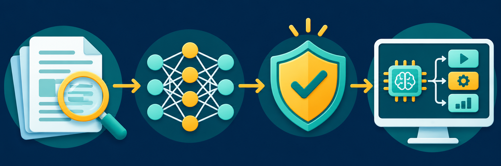
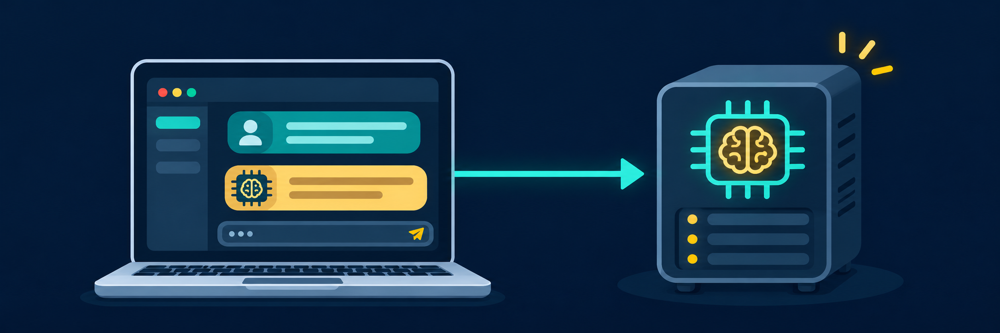

# Inteligencia artificial en el aula

Guía de consulta para el alumnado. Empieza por cómo encontrar información, explica cómo aprenden los modelos y termina con criterios para utilizar asistentes, agentes y modelos locales.

## Índice

1. [Buscadores e IA](#1-buscadores-e-ia)
2. [Entender la IA](#2-entender-la-ia)
3. [Uso responsable de la IA](#3-uso-responsable-de-la-ia)
4. [IA actuales](#4-ia-actuales)

## 1. Buscadores e IA

| Herramienta | Qué hace | Ejemplos |
| --- | --- | --- |
| Navegador | Abre páginas y permite usar aplicaciones web. | Firefox, Chrome, Edge, Brave |
| Buscador | Localiza páginas y ordena resultados relacionados con una consulta. | Google, Bing, DuckDuckGo |
| Asistente de IA | Redacta respuestas, resume documentos o ayuda a explicar y crear contenido. | ChatGPT, Gemini, Claude |
| Búsqueda con IA | Combina la consulta de fuentes con una respuesta redactada. | Perplexity, funciones de IA de los buscadores |

Usa un buscador para localizar documentos originales, un asistente para entenderlos o resumirlos y una búsqueda con IA para orientarte cuando hay varias fuentes. Si una respuesta incluye referencias, abre los enlaces y comprueba que realmente respaldan lo que afirma.

Las herramientas también se especializan por tarea. Algunas trabajan con apuntes y PDF, otras transcriben audio o vídeo, generan imágenes o leen textos en voz alta. Conviene elegir según el resultado que necesitas y los datos que puedes compartir.

## 2. Entender la IA

- **Inteligencia artificial (IA).** Campo de la informática que desarrolla sistemas capaces de realizar tareas como clasificar imágenes, interpretar lenguaje o recomendar contenido.
- **Aprendizaje automático (machine learning o ML).** Parte de la IA que ajusta modelos a partir de datos. Un clasificador entrenado con ejemplos etiquetados puede intentar reconocer una imagen nueva. Probarlo con datos que nunca ha visto permite evaluar si generaliza.
- **Aprendizaje profundo (deep learning o DL).** Parte del aprendizaje automático que emplea redes neuronales de muchas capas. Se utiliza en tareas como reconocimiento de voz e imágenes o generación de texto.
- **IA generativa.** Genera contenido nuevo a partir de patrones aprendidos. Un modelo de lenguaje procesa texto en *tokens* y genera su respuesta token a token usando el contexto disponible. Puede producir explicaciones plausibles con errores.
- **Chatbot.** Programa con una interfaz conversacional. Puede responder mediante reglas predefinidas o mediante un modelo generativo.

## 3. Uso responsable de la IA

### Cómo formular un prompt

Un *prompt* es la instrucción o pregunta que das al sistema. Indica **qué necesitas**, **para quién**, **qué material debe usar** y **cómo quieres la respuesta**. Puedes añadir un rol si aporta contexto. Una instrucción clara ayuda a orientar el resultado, que también depende del modelo y de las fuentes disponibles.

> Explica para alumnado de 4.º de ESO las causas de la Revolución francesa usando estos apuntes. Agrúpalas en causas sociales, económicas y políticas. Termina con un esquema e indica qué puntos no aparecen en el material.

### Cómo revisar una respuesta

- **Fiabilidad.** Comprueba cifras, citas y afirmaciones con fuentes originales. Una respuesta convincente puede incluir información inventada.
- **Privacidad.** Evita introducir nombres de alumnos, calificaciones, credenciales o documentos confidenciales. Utiliza datos ficticios o anonimizados cuando sea posible.
- **Autoría y transparencia.** Sigue las normas de la actividad, cita las fuentes utilizadas y explica qué parte del trabajo contó con ayuda de IA.
- **Sesgos.** Contrasta perspectivas y revisa si la respuesta reproduce estereotipos o deja fuera información relevante.
- **Aprendizaje.** Pide pistas, aclaraciones o comentarios sobre un borrador. Revisa el resultado y asegúrate de poder explicar con tus palabras lo que entregas.

## 4. IA actuales

### Herramientas fundamentales

| Herramienta | Compañía | Tipo | Para qué usarla |
| --- | --- | --- | --- |
| [ChatGPT](https://chatgpt.com/) | OpenAI | Asistente general | Explicar conceptos, resumir textos y revisar borradores. |
| [Gemini](https://gemini.google.com/) | Google | Asistente general | Consultar temas, redactar y trabajar con distintos tipos de contenido. |
| [Claude](https://claude.ai/) | Anthropic | Asistente general | Analizar documentos, ordenar ideas y revisar textos. |
| [Microsoft Copilot](https://copilot.microsoft.com/) | Microsoft | Asistente general | Hacer consultas, resumir información y preparar borradores. |
| [Perplexity](https://www.perplexity.ai/) | Perplexity | Búsqueda con IA | Investigar en la web y consultar los enlaces que acompañan la respuesta. |
| [NotebookLM](https://notebooklm.google/) | Google | Asistente para documentos | Hacer preguntas y preparar resúmenes a partir de los apuntes y fuentes que aportes. |

### Agentes principales de programación

Un **modelo** procesa la entrada y genera resultados. Una **aplicación** proporciona la interfaz. Un **agente** utiliza un modelo y herramientas para completar tareas de varios pasos. Según sus permisos, puede leer archivos, proponer cambios y ejecutar pruebas.

| Agente | Compañía | Qué permite hacer en VS Code |
| --- | --- | --- |
| [Codex](https://openai.com/codex/) | OpenAI | Revisar un proyecto, proponer cambios en varios archivos y ejecutar comprobaciones. |
| [Claude Code](https://code.claude.com/docs/en/vs-code) | Anthropic | Explorar el código, proponer cambios y revisar sus diferencias en el editor. |
| [Google Antigravity](https://antigravity.google/docs/ide/extensions/vscode/) | Google | Planificar tareas con el agente de Google y trabajar sobre los archivos del proyecto. |
| [GitHub Copilot](https://code.visualstudio.com/features/models) | GitHub | Usar el modo agente para editar archivos y encadenar comprobaciones desde el chat de VS Code. |

Antes de aceptar un cambio, revisa el *diff* para ver qué líneas se añadieron o eliminaron, y comprueba el resultado. Si tienes varios agentes abiertos, asigna a uno solo las ediciones de cada archivo para evitar cambios simultáneos.

### IA local

En el montaje de los apuntes, **Debian** es el sistema del servidor, **Ollama** carga y ejecuta un modelo como **Qwen** y **Open WebUI** ofrece una interfaz de chat que se comunica con Ollama mediante su API. También se puede interactuar con Ollama directamente desde la terminal.

| Concepto | Qué significa |
| --- | --- |
| Familia de modelos | Qwen, Llama, Gemma y DeepSeek tienen variantes que pueden ejecutarse localmente según su licencia y los recursos disponibles. |
| Parámetros | Una etiqueta como 9B indica aproximadamente 9.000 millones de parámetros. El tamaño influye en los recursos necesarios. |
| Tokens y contexto | Un token puede corresponder a una palabra, parte de ella o un signo. La ventana de contexto limita cuánto texto puede manejar el modelo en una ejecución. |
| RAM y VRAM | La RAM es la memoria del sistema y la VRAM es la memoria gráfica. El consumo depende del modelo, su cuantización y el contexto configurado. La cuantización reduce la precisión con la que se representan los parámetros para ahorrar memoria. |
| Local o nube | En local, el procesamiento puede hacerse en tu equipo o servidor. En la nube, se ejecuta en la infraestructura de un proveedor. Si la configuración local usa búsquedas o servicios externos, puede enviarles datos. |

[Open WebUI con Ollama](https://docs.openwebui.com/getting-started/quick-start/connect-a-provider/starting-with-ollama/) · [Longitud de contexto en Ollama](https://docs.ollama.com/context-length)

## Materiales de partida

- [Unidad 1 · Buscadores e IA](documentos/ud.1-Buscadores%20e%20ia.pptx)
- [Unidad 2 · Entender la IA](documentos/ud2.-Entender%20a%20la%20ia.pptx)
- [Unidad 3 · Uso responsable de la IA](documentos/ud3-Uso%20responsable%20de%20la%20ia.pptx)
